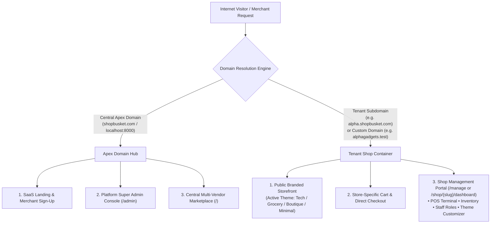

# GlobalShop — Multi-Tenant Hybrid SaaS Platform & Feature Testing Manual

> **System Version:** 2.0 (Hybrid SaaS Marketplace + Independent Subdomain Storefronts)  
> **Backend:** Laravel 13.18 (PHP 8.3)  
> **Frontend:** React 19.2 + Blade + Vite 8 + Tailwind CSS 4  
> **Database:** MySQL 8.0 (Production/Dev) | SQLite `:memory:` (Automated Test Suite)  
> **Verified Automated Tests:** **92 / 92 Passed** (475 assertions in < 4.0s)

---

## 🏛️ 1. Architecture & Domain Routing Blueprint

GlobalShop operates as a **hybrid multi-tenant e-commerce system**. It provides independent, branded web storefronts for every merchant while retaining the foundation for a central multi-vendor aggregator marketplace (Daraz/Amazon-style).

### Domain Topology



---

## 🔑 2. Master Test Credentials Directory

> [!NOTE]  
> All pre-configured testing accounts use the universal password: **`password`**

### 1. Platform Super Admin & Staff

| Role | Name | Email | Password | Allowed Access |
|---|---|---|---|---|
| **Super Admin** | Super Admin | `superadmin@marketplace.com` | `password` | Full system bypass, tenant store approvals/suspensions, plan quotas, admin permission matrix, audit logs. |
| **Platform Admin** | Grace Admin | `grace@marketplace.com` | `password` | Platform store management, subscription plans, ticket resolution, audit logs. |

---

### 2. Tenant Shop 1: Alpha Electronics (Tech Theme)

* **Public Storefront URL:** `http://alpha.shopbusket.com/` or `http://localhost:8000/store/alpha`
* **Custom Domain:** `http://alphaelectronics.test/`
* **Active Theme:** `tech` (High-contrast dark-mode header, cyan accents, spec badges)
* **Currency:** `USD ($)`
* **Catalog:** 4 Categories, 4 Brands (`Apple`, `Sony`, `ASUS ROG`, `Samsung`), 5 Tech Products

| Role | Name | Email | Password | Scope & Responsibilities |
|---|---|---|---|---|
| **Shop Owner** | John Owner | `john@alpha.com` | `password` | Full control over Shop Alpha (Catalog, POS Terminal, Theme Selector, Staff, Custom Domain). |
| **Manager** | Bob Manager | `bob@alpha.com` | `password` | Catalog management, inventory updates, customer management, POS sales terminal. |
| **Sales Manager**| Sam Sales | `sam@alpha.com` | `password` | Product catalog view & POS terminal sale execution. |
| **Worker** | Charlie Worker | `charlie@alpha.com` | `password` | View-only catalog access. |

---

### 3. Tenant Shop 2: Common Grocery (Grocery Theme)

* **Public Storefront URL:** `http://grocery.shopbusket.com/` or `http://localhost:8000/store/common-grocery`
* **Custom Domain:** `http://commongrocery.test/`
* **Active Theme:** `grocery` (Fresh green palette, sticky categories, quantity incrementors, weight units `kg`/`liter`)
* **Currency:** `BDT (৳)`
* **Catalog:** 4 Categories, 4 Brands (`Teer`, `Radhuni`, `Pran`, `Aarong Dairy`), 5 Daily Food Essentials

| Role | Name | Email | Password | Scope & Responsibilities |
|---|---|---|---|---|
| **Shop Owner** | Karim Chowdhury | `owner@commongrocery.com` | `password` | Full store control over Common Grocery. |
| **Manager** | Grocery Manager | `manager@commongrocery.com` | `password` | Stock monitoring, bulk updates, POS sales terminal. |
| **Cashier** | Grocery Cashier | `cashier@commongrocery.com` | `password` | In-store POS cashier execution. |

---

### 4. Tenant Shop 3: Velvet Couture (Luxury Boutique Theme)

* **Public Storefront URL:** `http://boutique.shopbusket.com/` or `http://localhost:8000/store/boutique`
* **Custom Domain:** `http://velvetcouture.test/`
* **Active Theme:** `boutique` (Deep violet/purple luxury palette, serif fonts, editorial lookbook layout)
* **Currency:** `EUR (€)`
* **Catalog:** 4 Categories, 3 Brands (`Velvet Atelier`, `Silk Route Paris`, `Aurelia Handcrafted`), 4 Luxury Fashion Products

| Role | Name | Email | Password | Scope & Responsibilities |
|---|---|---|---|---|
| **Shop Owner** | Sarah Sterling | `owner@boutique.com` | `password` | Full store control over Velvet Couture. |
| **Manager** | Boutique Manager | `manager@boutique.com` | `password` | Haute couture collection, staff management, sales terminal. |
| **Lead Stylist** | Lead Stylist | `stylist@boutique.com` | `password` | Sales & client styling terminal. |

---

### 5. Marketplace Customers

| Role | Name | Email | Phone | Password | Capabilities |
|---|---|---|---|---|---|
| **Customer** | Alice Customer | `alice@customer.com` | `01700000001` | `password` | Storefront cart, direct checkout, marketplace browsing, order history. |
| **Customer** | Bob Customer | `bob@customer.com` | `01700000002` | `password` | Direct checkout & order confirmation. |

---

## 🎨 3. Multi-Theme Storefront System

GlobalShop includes **4 built-in responsive themes** located in `config/themes.php`:

| Theme ID | Name | Category | Primary Colors | Distinct Features |
|---|---|---|---|---|
| `default` | **Modern Minimalist** | General Retail | Blue (`#2563EB`) & Slate | Clean whitespace, slide-out drawer, header announcement banner. |
| `grocery` | **Grocery & Daily Fresh** | Supermarket | Emerald Green (`#16A34A`) & Orange | Weight/unit badges (`kg`, `liter`, `pcs`), quick incrementors, category pills. |
| `boutique` | **Fashion & Luxury Boutique**| Haute Couture / Fashion | Regal Purple (`#9333EA`) & Gold | Serif luxury typography, editorial lookbooks, curated collection spotlights. |
| `tech` | **Tech & Digital Gadgets** | Electronics & Hardware | Electric Cyan (`#0284C7`) & Slate Dark | High-contrast dark cards, technical spec highlights, brand chips. |

### Live Theme Switcher for Storefronts
On any shop storefront, use the URL parameter `?preview_theme={theme_id}` to preview themes live:
* `http://localhost:8000/store/alpha?preview_theme=tech`
* `http://localhost:8000/store/alpha?preview_theme=grocery`
* `http://localhost:8000/store/alpha?preview_theme=boutique`
* `http://localhost:8000/store/alpha?preview_theme=default`

---

## 🧪 4. Step-by-Step Manual Feature Testing Guide

### Test Suite A: Platform Admin Testing (`/admin/login`)

1. **Sign In as Super Admin:**
   - URL: `http://localhost:8000/admin/login`
   - Email: `superadmin@marketplace.com` | Password: `password`
   - Expected: Enters Platform Admin Console showing total shops, active merchants, and subscriptions.
2. **Shop Approvals & Lifecycle:**
   - Navigate to `/admin/shops`.
   - View pending merchant registrations. Click **"Approve"** to activate a shop or **"Suspend"** to freeze foreign traffic with HTTP 403.
3. **Plan Quotas:**
   - Navigate to `/admin/plans`.
   - Verify limits (`max_products`, `max_categories`, `max_employees`).
4. **Audit Logs:**
   - Navigate to `/admin/logs`.
   - Verify that all shop registrations, catalog mutations, and login actions appear in chronological order.

---

### Test Suite B: Shop Owner & Staff Testing (`/shop/{slug}/dashboard`)

1. **Sign In as Shop Owner:**
   - URL: `http://localhost:8000/shop/alpha/login` (or use Developer Hub at `/shop/easy-login`)
   - Email: `john@alpha.com` | Password: `password`
   - Expected: Enters Shop Alpha Dashboard with management modules.
2. **Catalog Management (Tenant Scoped):**
   - Navigate to **Catalog Hub -> Products**.
   - Create a new product: Specify Name, Stock Quantity, Stock Unit (`pcs`, `kg`, `liter`), and Cost/Selling Price.
   - Use the **Canvas Image Editor** to crop, rotate, and zoom the product photo.
   - Save and verify the product appears immediately in Shop Alpha's catalog.
3. **Theme & Custom Domain Configuration:**
   - Send `GET /api/v1/tenant/theme` with owner session to fetch theme registry.
   - Send `PUT /api/v1/tenant/theme` with:
     ```json
     {
       "theme_slug": "tech",
       "theme_config": {
         "colors": { "primary": "#0284C7" },
         "announcement": { "enabled": true, "text": "Mega Summer Tech Sale!" }
       }
     }
     ```
   - Verify theme updates and announcement bar reflects on the storefront.
   - Configure Custom Domain via `POST /api/v1/tenant/custom-domain` (`custom_domain: "www.mytechstore.com"`).
4. **POS Terminal & Stock Deductions:**
   - Navigate to **Sales -> POS Terminal**.
   - Add items to the register and complete a Cash sale.
   - Verify that an invoice `INV-...` is generated and product `stock_quantity` decrements by the exact quantity sold.
5. **Partial / Full Refunds:**
   - Navigate to **Sales -> Refunds**.
   - Select an invoice and issue a partial refund for 1 item.
   - Verify refund approval and stock replenishment.

---

### Test Suite C: Public Storefront Customer Testing (`/store/{slug}`)

1. **Visit Shop Storefront:**
   - URL: `http://localhost:8000/store/alpha` (or `http://localhost:8000/store/common-grocery` or `http://localhost:8000/store/boutique`)
   - Expected: The page renders the store's custom branding, announcement banner, contact info, and active theme colors.
2. **Search & Filter:**
   - Use the top category pills (e.g. *Rice & Grains* on Grocery, or *Smartphones* on Tech).
   - Type in the search box to filter products in real-time.
   - Switch the sort dropdown between *Price: Low to High*, *High to Low*, and *Latest*.
3. **Shopping Cart Drawer:**
   - Click **"Add"** on any in-stock product.
   - The slide-out cart drawer smoothly slides from the right.
   - Increment quantity (`+`), decrement (`-`), or test stock ceiling warnings.
4. **Direct Checkout & Invoice Receipt:**
   - Click **"Proceed to Checkout"**.
   - Fill in customer name, phone number (`01700000001`), payment method, and address.
   - Click **"Confirm & Place Order"**.
   - Expected: SweetAlert2 modal displays confirmation with the generated `INV-...` invoice number and stock is updated.

---

### Test Suite D: Tenant Catalog Isolation Verification

* Visit `http://localhost:8000/store/alpha` -> Verify only Tech items appear (`iPhone 15 Pro Max`, `Sony Headphones`, `ASUS ROG`).
* Visit `http://localhost:8000/store/common-grocery` -> Verify only Grocery items appear (`Teer Nazirshail Rice`, `Radhuni Mustard Oil`, `Aarong Ghee`).
* Visit `http://localhost:8000/store/boutique` -> Verify only Haute Couture fashion items appear (`Emerald Velvet Gown`, `Katan Silk Saree`).
* **Zero Cross-Tenant Leakage:** Products from Shop Alpha never appear in Common Grocery or Velvet Couture.

---

## 💻 5. Running the Automated Test Suite

Execute the entire test suite via PHP CLI:

```bash
php artisan test
```

### Result Summary
```text
PASS  Tests\Unit\ExampleTest
PASS  Tests\Feature\CommonGroceryShopTest
PASS  Tests\Feature\EasyLoginTest
PASS  Tests\Feature\ExampleTest
PASS  Tests\Feature\MarketplaceCustomerAuthTest
PASS  Tests\Feature\MarketplaceTest
PASS  Tests\Feature\ProfileTest
PASS  Tests\Feature\RefundTest
PASS  Tests\Feature\SalesTest
PASS  Tests\Feature\ShopMultiTenantTest
PASS  Tests\Feature\ShopRegistrationApprovalTest
PASS  Tests\Feature\StockUnitTest
PASS  Tests\Feature\SubdomainAndThemeTest
PASS  Tests\Feature\SupportTicketAndUserDirectoryTest

Tests:    92 passed (475 assertions)
Duration: 3.85s
```

---

## 📦 6. Implementation Snapshot & Status

| Milestone | Component | Status | Notes |
|---|---|---|---|
| **Subdomain & Custom Domain Routing** | `shops` schema + `ResolveTenant` middleware | **Complete & Verified** | Supports `{subdomain}.shopbusket.com`, custom domains, and local `/store/{slug}` fallbacks. |
| **Multi-Theme Registry Engine** | `config/themes.php` + `ThemeService` | **Complete & Verified** | 4 themes (`default`, `grocery`, `boutique`, `tech`) with dynamic CSS palettes and JSON configs. |
| **Dedicated Storefront UI & Cart** | `resources/views/storefront.blade.php` | **Complete & Verified** | Responsive hero section, category filters, slide-out cart drawer, and instant checkout. |
| **Theme & Domain Management API** | `ThemeController` (`GET/PUT /api/v1/tenant/theme`) | **Complete & Verified** | Allows shop owners to switch themes and configure custom domains. |
| **3 Distinct Populated Tenant Stores** | `ComprehensiveDemoShopsSeeder` | **Complete & Verified** | Populated Tech, Grocery, and Boutique shops with realistic Bangladeshi and international catalogs. |
| **Automated Test Coverage** | `SubdomainAndThemeTest.php` | **Complete & Verified** | 92/92 tests passing. |
| **Future Central Marketplace (Daraz-Style)** | Shared database schema (`shop_id` scoping) | **Database-Ready** | Apex marketplace can aggregate products from all active shops at any time. |
